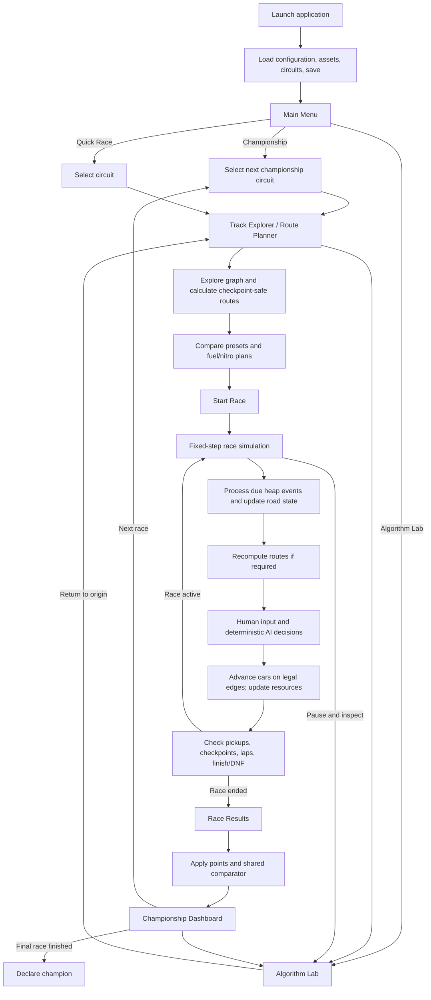
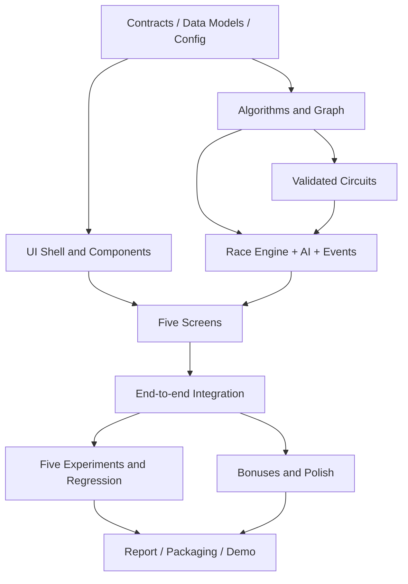

# Smart Racing Championship — Complete Assignment & Agentic Implementation Guide

> **Project:** Smart Racing Championship — The Algorithmic Racing Challenge  
> **Course:** Design and Analysis of Algorithms (DAA)  
> **Deadline:** **05 December 2026, 11:59 PM**  
> **Deliverable:** 2D top-down racing desktop application, source code, assets, integrated algorithm visualization, five experiments, technical report, demo/viva, and ZIP submission  
> **Recommended implementation:** Python 3.12 + Pygame 2.6.x  
> **Status:** Planning and implementation blueprint; illustrations, code snippets, values marked “proposed” are not completed software.

## How to read this guide

- **[REQUIRED]**: Explicitly required by the supplied `Project.pdf`.
- **[SUGGESTED IN PDF]**: Suggested default or recommendation in the assignment; teams may tune and document it.
- **[BONUS]**: Advanced challenge, not compulsory unless the instructor says otherwise.
- **[PROPOSED]**: Our architecture, interface, technology, and implementation decision—not prescribed by the assignment.

The source of truth for grading is `Project.pdf`. This guide integrates its requirements with a practical design plan. Where a rule is not specified in the PDF, we identify the decision as proposed instead of treating it as official.

---

# 1. Assignment purpose, objectives, and deliverables

## 1.1 What are we supposed to build?

**[REQUIRED]** Build a functional **2D top-down racing championship game** on a changing graph-based road network. The player must explore tracks, compare routes, manage fuel and nitro, navigate dynamic road events, race against deterministic AI opponents, and review race/championship results. The algorithms must be functional parts of the game, not detached demonstrations.

**The purpose is algorithm design, implementation, analysis, integration, and experimental validation.** This is **not primarily a graphics project**. No machine learning or reinforcement learning is needed; opponents follow deterministic strategies.

## 1.2 Minimum assignment scope

| Dimension | Minimum |
|---|---|
| Playable circuits | 3 |
| Mandatory checkpoints | 10 per circuit, in required order |
| Shortcuts | 2 per circuit |
| Racers | 1 human + at least 3 deterministic AI |
| GUI screens | 5 |
| Mandatory algorithm families | 12 |
| Experimental studies | 5 |
| Advanced challenges | 3, extension/bonus |
| Race | Multiple laps, dynamic events, resource management |
| Deliverables | Executable, source, assets, setup/run instructions, visualizations, report, experiments, demo/viva |

**[REQUIRED]** Group size is **up to three members**. One member submits for the group through Google Classroom; all members must contribute, understand the implementation, and attend the demo/viva. Submit a ZIP named with the actual registration numbers followed by section, e.g. `24I-XXXX_24I-YYYY_24I-ZZZZ_Section.zip`. Acknowledge permitted third-party libraries and assets. Verify the archive is complete, uncorrupted, and free of malware. Do not copy code from other groups. Late submission is subject to official course policy.

## 1.3 Success definition

A successful project:
1. Runs from a clean installation/extracted package.
2. Has three valid, playable circuits and a complete championship.
3. Implements all 12 required algorithm families in original project code.
4. Invokes those algorithms from real gameplay and the Algorithm Lab.
5. Includes all five screens with functioning controls and navigation.
6. Handles edge cases, dynamic changes, fuel constraints, and deterministic AI.
7. Produces reproducible raw measurements and all five required experiments.
8. Has a complete technical report, source, assets, README, and demo-ready executable.

---

# 2. Final recommended technology stack

**[REQUIRED]** The PDF does **not** prescribe C++, Python, a game engine, database, operating system, or IDE. It does prescribe adjacency-list graph representation and the required algorithmic/functional behavior.

| Component | Proposed technology | Why |
|---|---|---|
| Language | Python 3.12 | Fast development, accessible algorithm code |
| Game/window/rendering | Pygame 2.6.x | 2D graphics, animation, keyboard/mouse, audio |
| UI | Custom reusable Pygame widgets | Consistent visual identity and full control |
| Optional UI helper | `pygame_gui` | Scroll areas, forms, complex controls if needed |
| Algorithms | Original pure Python implementations | Grading, correctness, tracing, benchmarking |
| Graph storage | Custom adjacency lists | Explicit PDF requirement |
| Track/rules data | JSON (`json`) | Human-readable, versionable |
| Results/measurements | CSV (`csv`) | Reproducible experiments |
| Numerical analysis | NumPy (optional) | Aggregate benchmark results |
| Analysis tables | Pandas | Experiment processing |
| Plots | Matplotlib | Figures for report |
| Testing | pytest | Automated tests |
| Timing | `time.perf_counter_ns()` | Fine-grained timings |
| Quality | Ruff + type hints | Maintainability |
| Packaging | PyInstaller | Desktop executable |
| Dependencies | `venv`, pinned requirements | Reproducibility |
| Version control | Git/GitHub | Branches, code reviews, teamwork |
| IDE | VS Code or PyCharm | Developer preference |
| Documentation | Markdown, report exported to PDF | Design and submission |

**Do not add** React, a web backend, cloud hosting, login, or a database without a clear need. **Do not** use NetworkX to replace required graph algorithms or built-in sorting as the mandatory sorting implementation. Standard containers can support the implementation; the algorithm logic must be written by the team.

### Suggested setup

```bash
python -m venv .venv
# Windows:
.venv\Scripts\activate
# Linux/macOS:
source .venv/bin/activate
python -m pip install --upgrade pip
pip install pygame==2.6.1 pytest pandas matplotlib ruff pyinstaller
python main.py
pytest -q
```

Pin and test the actual versions on the team's development machine before release. A `requirements.txt` should reflect tested versions rather than blindly assuming compatibility.

---

# 3. Complete end-to-end system workflow



**Core strategic loop:** **Plan** (BFS/DFS exploration, Dijkstra/A* routing, DP/Greedy resources) → **Race** (movement, fuel, nitro, event heap, rerouting) → **Review** (results, Merge/Quick/Heap Sort, top-k) → repeat.

### Full user journey
1. Open application, load configuration, show Main Menu.
2. Choose Championship, Quick Race, or Algorithm Lab.
3. Select a circuit (or follow championship order).
4. Inspect graph, reachability, checkpoint order, alternative paths, road properties, and services.
5. Choose route algorithm and cost preset; compare at least two candidates.
6. Inspect fuel/refuelling and nitro/pickup recommendations.
7. Start race with one human and at least three AI.
8. Simulate edge-constrained car movement, ordered checkpoints, resources, events, and rerouting.
9. When all finish or time limit expires, resolve finish/DNF order and award points.
10. Sort standings using shared comparator; show top-k.
11. Continue to next circuit; declare champion after final race.
12. Open Algorithm Lab at any time appropriate to inspect the **same implementation** and its counters.

---

# 4. Architecture and engineering principles

```text
Pygame Presentation
  ├── Main Menu
  ├── Track Explorer
  ├── Racing Screen
  ├── Algorithm Lab
  └── Championship Dashboard
          ↓
Application Controllers / Screen Manager
          ↓
Domain Services
  ├── Graph + Route Planner
  ├── Algorithm Library + Traces
  ├── Race Engine + AI + Resources
  ├── Dynamic Event Engine
  ├── Championship + Ranking
  └── Experiments / Metrics
          ↓
JSON Circuits, Configuration, Saves, CSV Results
```

### Non-negotiable engineering rules

1. **One authoritative `RaceState`**: GUI only reads state and sends commands.
2. **Pure algorithms**: algorithms import no Pygame; easy to test and benchmark.
3. **Same code, two modes**: gameplay and lab share implementations; lab enables trace collection.
4. **Deterministic simulation**: fixed timestep, seeded generation, ordered event keys and deterministic AI.
5. **Rendering independence**: simulation result must not depend on monitor FPS.
6. **Immutable/base graph attributes**: dynamic effects are layered on base edge data; expiry does not accidentally erase other effects.
7. **Explicit invalid/unreachable handling**: no infinite loops or silent freezes.
8. **Documented rule decisions**: configurable parameters frozen before experiments.
9. **Algorithm counters and tests from day one**, not bolted on at the end.
10. **No dead UI controls**: every visible button performs an action or is visibly disabled.

### Suggested core interfaces

```python
@dataclass(frozen=True)
class Vertex:
    id: int
    x: float
    y: float
    type: str
    checkpoint_order: int | None = None
    active: bool = True

@dataclass(frozen=True)
class Edge:
    id: str
    source: int
    target: int
    distance: float
    base_time: float
    fuel_cost: float
    difficulty: int
    directed: bool
    is_shortcut: bool

@dataclass
class RacerState:
    racer_id: int
    name: str
    is_human: bool
    strategy_type: str
    current_vertex: int
    current_edge_id: str | None
    edge_progress: float
    fuel: float
    nitro_charges: int
    lap: int
    next_checkpoint: int
    total_time: float
    route: list[int]
    status: str

@dataclass
class AlgorithmTraceStep:
    operation: str
    state: dict
    counters: dict[str, int]
```

Define `Graph.neighbors(vertex_id, graph_state)`, `Graph.get_edge(edge_id)`, `RoutePlanner.plan(...)`, `RaceEngine.step(dt, commands)`, `EventQueue.push/pop/cancel`, `AlgorithmRunner.run(..., trace=None)`, and `ChampionshipManager.apply_result(...)` as stable interfaces. Treat these snippets as design examples, not complete implementation.

---

# 5. Data model and graph representation

## 5.1 Graph

**[REQUIRED]** Each circuit is \(G=(V,E)\), stored using adjacency lists, with approximately \(O(V+E)\) graph memory. An adjacency matrix uses \(O(V^2)\) memory and is less suitable for sparse road networks.

### Vertex fields

| Field | Meaning |
|---|---|
| `id` | Unique integer |
| `x`, `y` | Map coordinates; may support A* heuristic |
| `type` | Start, Finish, Checkpoint, Intersection, FuelStation, NitroPickup, DeadEnd |
| `checkpointOrder` | Required order or null |
| `active` | Service availability |

### Edge fields

| Field | Meaning |
|---|---|
| `id` | Unique event-addressable identifier |
| `from`, `to` | Endpoints |
| `distance` | Non-negative length |
| `baseTime` | Non-negative normal travel time |
| `fuelCost` | Non-negative base fuel |
| `difficulty` | Integer 1–5 |
| `status` | Open, Blocked, Restricted |
| `isShortcut` | Designated shortcut flag |
| `directed` | True = one-way; false = both directions |

**[REQUIRED]** Dynamic block/unblock and service activation/deactivation must work without rebuilding the entire graph. Blocked edges are excluded from routing; restricted edges remain traversable with updated effective costs.

### Other required records
- `Racer`: id, name, isHuman, strategyType, currentVertex, fuel, nitroCharges, lap, nextCheckpoint, totalTime.
- `RaceResult`: raceId, racerId, finishPosition, finishTime, fastestLap, bonusPoints, pointsAwarded.
- `ChampionshipEntry`: racerId, totalPoints, wins, sumOfFinishPositions, bestFastestLap.
- `Event`: eventId, type, triggerTime, priority, insertionSequence, targetEdgeOrVertex, duration, cancelled.

## 5.2 JSON circuit schema [PROPOSED]

```json
{
  "id": "circuit_01",
  "name": "Emerald Loop",
  "laps": 2,
  "start_vertex": 0,
  "finish_vertex": 0,
  "vertices": [
    {"id": 0, "x": 100, "y": 120, "type": "Start", "checkpointOrder": null, "active": true},
    {"id": 1, "x": 180, "y": 100, "type": "Checkpoint", "checkpointOrder": 1, "active": true}
  ],
  "edges": [
    {"id": "E001", "from": 0, "to": 1, "distance": 80,
     "baseTime": 5, "fuelCost": 4, "difficulty": 1,
     "status": "Open", "isShortcut": false, "directed": false}
  ],
  "events": []
}
```

This is an **illustrative fragment**, not a valid complete circuit: a playable file needs at least ten ordered checkpoints, two shortcuts, cycle, dead end, alternative paths, service locations, and fuel-feasible lap traversal.

## 5.3 Weighted route cost

**[REQUIRED]** Use non-negative scalar edge cost:

\[
C(e)=w_dD(e)+w_tT(e)+w_fF(e)+w_rR(e)+w_oO(e)
\]

where terms are **normalized** distance, time, fuel, difficulty penalty, and obstacle penalty. Weights must be non-negative. The displayed cost must be exactly the cost optimized. Document reference values, weights, and rationale.

**[PROPOSED]** Example normalized presets:

| Preset | Distance | Time | Fuel | Difficulty | Obstacle |
|---|---:|---:|---:|---:|---:|
| Balanced | .20 | .30 | .20 | .15 | .15 |
| Speed | .10 | .65 | .10 | .10 | .05 |
| Economy | .15 | .15 | .55 | .10 | .05 |
| Safety | .10 | .15 | .10 | .35 | .30 |

Normalize by documented reference values, e.g. \(D_n=D/D_\text{ref}\), and choose equivalent definitions for the remaining terms. Freeze them before testing. **[REQUIRED]** Demonstrate at least one circuit where presets select different routes.

---

# 6. Circuits and complete map plan

**[REQUIRED]** Each circuit needs at least ten ordered checkpoints, two shortcuts, multiple intersections, alternative routes, at least one cycle and dead end, road difficulty levels, fuel stations, nitro pickups, obstacles/closures, and multiple laps.

**[PROPOSED]** Design three visually distinct circuits:

| Circuit | Topology | Target vertices | Target edges | Checkpoints | Shortcuts | Fuel stations | Nitro pickups |
|---|---|---:|---:|---:|---:|---:|---:|
| Emerald Loop | Outer loop + inner connectors | 24 | 34 | 10 | 2 | 2 | 3 |
| Canyon Switchbacks | Branches, hills, risky detours | 30 | 46 | 10 | 3 | 3 | 3 |
| Metro Grid | Dense grid, one-way segments | 36 | 58 | 10 | 4 | 3 | 4 |

These counts are **targets**, not assignment-mandated values. Adjust if validation requires it.

### Circuit 1 — Emerald Loop
- Green terrain, broad outer circuit, two inner shortcuts, easy-to-read checkpoint sequence.
- Suitable for introducing BFS/DFS and explaining shortest-hop versus minimum-distance paths.
- Place one dead-end service spur and at least two feasible ways around a closure.
- Fuel stations spaced to support a valid full-race plan.

### Circuit 2 — Canyon Switchbacks
- Amber/brown canyon theme; longer roads, higher difficulties, branching detours.
- Short but difficult shortcut contrasted with longer fuel-efficient road.
- Include at least one dynamic closure that forces a reroute.
- Showcase DP/Greedy fuel/pickup choices and A* search.

### Circuit 3 — Metro Grid
- Dark urban grid, more intersections, optional one-way roads, overlapping restrictions.
- Several alternative paths with distinct time/fuel/safety profiles.
- Showcase simultaneous events, heap scheduling, dynamic routing, and cost presets.

### Track map rendering rules
- Road surface: slate gray with dashed centerline.
- Normal edge: neutral; selected route: solid cyan; alternative: dashed amber.
- Shortcut: purple patterned outline.
- Blocked: red hatch/cross icon; restricted: amber striped icon.
- Checkpoints: numbered circles; current checkpoint: bright ring; visited: check mark.
- Fuel station: pump icon; nitro pickup: lightning icon; finish: flag.
- One-way edges: directional arrows.
- Racer icons: distinguishable colors plus initials/shapes.
- Graph IDs and weights are toggles so the game map remains clean.

### Track validator — acceptance criteria
- Unique vertex/edge IDs; all edge endpoints exist.
- Non-negative distance/time/fuel; difficulty 1–5.
- Valid start, finish, and ten checkpoint orders.
- Minimum shortcuts, cycle, dead end, alternative start-finish paths.
- Directed legal route through all checkpoints and lap return.
- At least one feasible fuel plan; no impossible mandatory resource dependency.
- Services/pickups reachable and event targets valid.
- Closure/restriction effects valid and safe.
- Reject invalid generated tracks with reason and bounded retries.

---

# 7. Global GUI design system

**[PROPOSED]** Desktop app target **1440×900**, minimum **1280×720**, target **60 FPS**, fixed simulation timestep **1/60 second**. Use responsive layout and optional camera zoom/pan.

## 7.1 Palette

| Purpose | Hex |
|---|---|
| Background | `#0B1220` |
| Panel | `#172338` |
| Elevated panel | `#23334C` |
| Primary cyan | `#38BDF8` |
| Success emerald | `#34D399` |
| Warning amber | `#FBBF24` |
| Danger rose | `#FB7185` |
| Primary text | `#F8FAFC` |
| Secondary text | `#CBD5E1` |

Use clear contrast, 14–16 px+ body labels at base resolution, 44 px+ click targets, consistent margins, rounded panels, keyboard focus, descriptive tooltips, icons **with** text, and patterns as well as colors. Dark overlays protect text over busy maps. Do not use color alone to identify closure, danger, or progress.

## 7.2 Shared widgets

Implement reusable:
- `Button`, `IconButton`, `Dropdown`, `Slider`, `Toggle`, `TabBar`.
- `Panel`, `Modal`, `Tooltip`, `Toast`, `ScrollView`.
- `FuelGauge`, `NitroIndicator`, `ProgressBar`, `StatCard`, `DataTable`.
- `GraphCanvas`, `RouteLegend`, `AlgorithmStepController`, `EventTimeline`.

Each widget handles hover, pressed, focus, disabled, and keyboard/mouse states. Define a `ScreenManager` with explicit origin screen so Algorithm Lab returns correctly.

### Common layout
- Header: ~72 px, screen title, context, back/help/settings.
- Main content: responsive center and optional sidebars.
- Side panel: ~300–360 px when present.
- Footer: status and primary action.
- Modals: center overlay with visible Cancel/Confirm.

---

# 8. Screen 1 — Main Menu

## Goal
Offer clear entry to championship, single race, and algorithm exploration.

### Wireframe

```text
┌──────────────────────────────────────────────────────────────────────────────┐
│ SMART RACING CHAMPIONSHIP                           [Sound] [Settings]      │
│ THE ALGORITHMIC RACING CHALLENGE                                         │
├──────────────────────────────────────────────────────────────────────────────┤
│                                                                              │
│   [ START CHAMPIONSHIP ]        [Animated cars + winding track artwork]     │
│   [ QUICK RACE        ]                                                   │
│   [ ALGORITHM LAB     ]        Current season / last results preview         │
│   [ HOW TO PLAY       ]                                                   │
│   [ SETTINGS          ]                                                   │
│   [ EXIT              ]                                                   │
│                                                                              │
│  Footer: DAA project | Controls | Version                                   │
└──────────────────────────────────────────────────────────────────────────────┘
```

### Button contract

| Control | Placement | Action |
|---|---|---|
| Start Championship | Left, top primary button | If no save: initialize season → Track Explorer circuit 1; if save: Continue/New/Cancel modal |
| Quick Race | Left below primary | Open Track Explorer with circuit selector |
| Algorithm Lab | Left | Open lab with default/last selected circuit |
| How to Play | Left | Modal tabs: Controls, Race Rules, Algorithms |
| Settings | Top-right and/or left | Modal for resolution, audio, keybindings, animation speed |
| Sound | Top-right | Toggle sound |
| Exit | Left bottom | Confirm then close |

**States:** show existing championship progress, disabled Continue if no save, confirm destructive New Championship, show loading/errors clearly.

---

# 9. Screen 2 — Track Explorer / Route Planner

## Goal
Display graph, reachable checkpoints, alternative paths, route costs, comparison, and resource recommendations using BFS, DFS, Dijkstra, A*.

### Wireframe

```text
┌──────────────────────────────────────────────────────────────────────────────┐
│ [Back] TRACK EXPLORER | Circuit [<][Name][>]   [Help] [Generate Track*]     │
├───────────────────────────────────────────────┬──────────────────────────────┤
│                                               │ ROUTE PLANNER                │
│      INTERACTIVE CIRCUIT MAP                  │ Start [vertex ▼]             │
│      Roads, intersections, checkpoints        │ Destination [vertex ▼]       │
│      Fuel, nitro, blocked edges, cars         │ Algorithm [Dijkstra ▼]       │
│                                               │ Preset [Balanced ▼]          │
│      [Zoom +] [Zoom -] [Reset View]            │ [Calculate Route]            │
│      [Graph] [Weights] [Checkpoints]          │ [Compare Routes]             │
│                                               │                              │
│                                               │ Route distance/time/fuel/cost│
│                                               │ [Fuel & Nitro Plan]          │
├───────────────────────────────────────────────┴──────────────────────────────┤
│ [BFS] [DFS] [Dijkstra] [A*] [Algorithm Lab]             [ START RACE ]      │
└──────────────────────────────────────────────────────────────────────────────┘
```

`*` Generate Track is an advanced challenge control.

### Detailed controls
- **Back** top-left → Main Menu/previous dashboard.
- **Circuit arrows** top bar → select circuit in Quick Race; locked to prescribed order in championship.
- **Generate Track** top bar → generator panel; display candidate/rejection reasons.
- **Zoom ± / Reset View** on map toolbar → zoom/pan reset.
- **Graph/Weights/Checkpoints toggles** → overlays without modifying graph.
- **Vertex click** → ID, type, checkpoint order, availability, neighbors.
- **Edge click** → ID, endpoints, distance, time, fuel, difficulty, status, shortcut, direction, weighted cost.
- **Start/Destination selectors** right → choose vertices.
- **Algorithm dropdown** → BFS/DFS/Dijkstra/A*.
- **Preset dropdown** → Balanced/Speed/Economy/Safety.
- **Calculate Route** → run selected algorithm and highlight result.
- **Compare Routes** → at least two legal candidates, distance/time/fuel/scalar cost; show unavailable cases.
- **Fuel & Nitro Plan** → resource tab with DP/Greedy comparison and stop suggestions.
- **Algorithm Lab** bottom-left → lab with current graph/algorithm.
- **Start Race** bottom-right → validate configuration and open Racing Screen.

### Route logic
1. Read graph and active event effects.
2. Determine next required checkpoint.
3. Calculate route leg to that checkpoint, then each later checkpoint and finish.
4. Reject paths that illegally pass mandatory checkpoints out of order (model checkpoint progress explicitly).
5. Concatenate legs, calculate metrics and feasibility.
6. Show alternate legal paths and explanations.
7. On graph changes, replan from the **current state**, not from original start.

**Important:** BFS minimizes edge count, not distance/time/weighted cost. DFS supports exploration; enumerating all simple paths can be exponential, so impose path-length/count limits.

---

# 10. Screen 3 — Racing Screen

## Goal
Show real animated cars on graph roads, race progress, fuel, nitro, time, position, dynamic events, route decisions, and controls.

### Wireframe

```text
┌──────────────────────────────────────────────────────────────────────────────┐
│ [Pause] Circuit 01 | Lap 1/2 | CP 04/10   Time 01:24.58   Position 2/4      │
├────────────────────────────────────────────────────┬─────────────────────────┤
│                                                    │ MINI MAP / ROUTE        │
│          MAIN TOP-DOWN RACING TRACK                │ Next CP: 05            │
│          4 animated cars on legal edges            │ Road status: OPEN      │
│          Road effects / shortcuts / pickups        │ [Recalculate Route]    │
│                                                    │ [Preset ▼]             │
│                                                    │ EVENT LOG              │
│                                                    │ Recent road changes    │
├────────────────────────────────────────────────────┴─────────────────────────┤
│ Fuel [██████░░░░] 72/100   Nitro [⚡⚡○]  Speed 64  [NITRO] [REFUEL*]       │
│ W accelerate | S brake | A/D choose legal edge | Enter confirm | P pause   │
└──────────────────────────────────────────────────────────────────────────────┘
```

`*` Refuel is enabled only at an eligible active station.

### Controls and navigation

| Control | Location | Action |
|---|---|---|
| Pause | Top-left/top-right | Freeze simulation, open Pause overlay |
| Resume | Pause overlay | Return to race |
| Restart Race | Pause overlay | Confirm; restart current race |
| Algorithm Lab | Pause overlay | Open lab while preserving paused state |
| Main Menu | Pause overlay | Confirm save/restart policy |
| Minimap | Right | Show current/alternative route |
| Route Details | Right | Next edges, checkpoint, estimated costs |
| Recalculate Route | Right | Recompute legal route |
| Preset | Right | Change objective weights |
| Event Log | Right | Show recent events |
| Nitro | Bottom-right | Consume charge and activate boost |
| Refuel | Bottom-right contextual | Choose fuel amount at station |
| Camera Follow | Map toolbar | Follow racer |
| Zoom ± | Map toolbar | Change camera scale |
| Help | Pause overlay | Rules and controls |

### Proposed keyboard bindings
- `W` / Up: accelerate along selected legal edge.
- `S` / Down: brake.
- `A`/`D` or Left/Right: cycle through legal outgoing roads at intersection.
- `Enter`: confirm selected road.
- `Space`: nitro.
- `R`: refuel at eligible station.
- `P`/`Esc`: pause.
- `M`: minimap.
- `Tab`: route information.

**[PROPOSED]** Use **route-guided edge movement**, not unrestricted physics. Cars travel along graph edges and can only choose valid outgoing edges. Interpolate sprite position \(P(t)=(1-t)A+tB\), \(0\le t\le1\). Curved road sprites can follow a polyline while retaining one logical edge.

### Simulation tick order [PROPOSED]

```text
1. Advance fixed simulation clock
2. Extract/apply all due events in heap order
3. Recompute effective road/service state
4. Replan affected racers
5. Process human input and deterministic AI
6. Update movement, speed, fuel, nitro
7. Process arrivals, pickups and refuelling
8. Validate ordered checkpoints and lap crossings
9. Resolve finish/DNF/time-limit status
10. Publish state for rendering
```

**[PROPOSED]** A car already traversing an edge when it closes may finish that edge, then replan at its next vertex; document the policy. Never teleport or silently freeze.

### Racing results overlay
When the race ends, show finishing order, time, fastest lap, checkpoint/lap status, DNF, points, and buttons **View Championship**, **Replay Quick Race** (when allowed), and **Main Menu**. The overlay leads to Championship Dashboard.

---

# 11. Racing rules, fuel, nitro, and resource planning

## 11.1 Race rules [REQUIRED]
- All racers begin at start with full fuel and configured initial nitro.
- Fixed multiple laps (PDF recommends 2 or 3).
- Lap only counts after all mandatory checkpoints in order and crossing lap boundary.
- Skipping checkpoint requires returning and visiting it correctly.
- Shortcuts usable only when open and legal.
- Movement only along valid graph edges.
- Insufficient fuel for next edge → stop; if no permitted recovery/refuelling route → DNF.
- Finish order by finish time; exact tie by lower racer ID.
- Optional time limit: unfinished racers ranked by laps, checkpoints, elapsed time, racer ID; state point policy.

## 11.2 Fuel [SUGGESTED IN PDF]
- Maximum fuel: **100**.
- Edge fuel: `fuelCost × (1 + 0.1 × (difficulty - 1))`.
- Refuel: up to **40 units per stop**, respecting tank capacity.
- Positive fuel purchase incurs fixed stop-time penalty.
- Same rules for human and AI.

Example: base fuel 10 at difficulty 3 costs \(10×1.2=12\) units before boost.

**Implementation:** `FuelManager.can_enter_edge`, `consume_edge_segment`, `can_refuel`, `purchase_fuel`. Validate remaining capacity, station availability, and non-negative amounts. If fuel is fractional, document scaling/discretization for DP.

## 11.3 Nitro [SUGGESTED IN PDF]
- Maximum **3 charges**, active pickups restore charges up to cap.
- One charge per activation.
- **1.5× speed for 4 seconds**.
- **2× fuel consumption while active**.
- Boost can expire mid-edge; compute boosted and normal segments separately.
- Same rules for AI and player.

UI: three charge icons, boost countdown, clear fuel penalty tooltip, short visual speed trail.

## 11.4 Fuel and nitro planning panel
- Route timeline with upcoming checkpoints and service locations.
- Current fuel, projected fuel after each leg, tank cap.
- Refuelling opportunities and fixed time penalties.
- Pickup benefit, detour cost, and budget.
- DP versus Greedy selected pickups and benefits.
- Nitro timing suggestions and estimated fuel trade-off.
- Feasibility indicator: **Feasible / Insufficient fuel / Unreachable**.

### DP implementation
**[REQUIRED]** 0/1 Knapsack and/or refuelling DP. Recommended: implement both if time permits.
- Knapsack: `dp[i][budget]` maximum benefit, reconstruct selected items.
- Refuelling: discrete states `(route_position, fuel_units)` minimizing stop penalties subject to capacity, consumption and max purchase.
- Explain state-space size and fractional scaling.

### Greedy implementation
Sort optional pickups by benefit/cost ratio with deterministic tie-break. Respect budget and feasibility. Greedy is not guaranteed optimal.

**Supplied PDF counterexample:** budget 10, A `(cost 6, benefit 30)`, B `(5,24)`, C `(5,24)`. Ratio Greedy chooses A for benefit 30, while DP chooses B+C for 48. Include at least two additional strictly suboptimal Greedy cases in experiments.

---

# 12. Deterministic AI opponents

**[REQUIRED]** Identical track, event sequence, and initial conditions must yield identical opponent behavior. No ML.

| Opponent | Main strategy | Closure response | Refuelling |
|---|---|---|---|
| AI 1 | Fixed main route stored per circuit | Documented fixed detour, otherwise wait/recover | First eligible station below 25% fuel |
| AI 2 | Designated shortcut whenever open/legal | Fall back to main route | First eligible station below 25% fuel |
| AI 3 | Minimum total distance route | Recompute shortest-distance route | Nearest reachable station on route below 25% fuel |

All AI obey checkpoint order, fuel limits, and legal edges. Define one shared recovery policy unless a rule explicitly differs. Record waiting, rerouting, DNF, and elapsed time accounting.

**Implementation:** `BaseStrategy.choose_next_edge(state, graph)`, plus `FixedRouteAI`, `ShortcutAI`, `ShortestDistanceAI`. Strategy output is validated by `RaceEngine` before movement. Add replay tests with same seed and event schedule.

---

# 13. Dynamic events and custom min-heap

**[REQUIRED]** Min-heap key:
`(triggerTime, priority, insertionSequence)`. Lower priority number first for same time; insertion sequence breaks all remaining ties.

| Priority | Event | Effect | Typical duration |
|---:|---|---|---|
| 1 | Road blockage | Block edge; remove from routing | Until cleared |
| 2 | Shortcut open/close | Toggle shortcut | Until reversed |
| 3 | Oil spill | Increase difficulty/reduce speed | About 20 s |
| 4 | Speed restriction | Cap speed | About 15 s |
| 5 | Fuel station availability | Activate/deactivate service | About 30 s |
| 6 | Nitro booster | Activate pickup | Until collected or about 25 s |

### Exact processing workflow
1. Validate event target and state.
2. Insert event into custom binary heap.
3. On each tick, extract all due events in tuple order.
4. Apply all same-time events **before** route recalculation.
5. Store overlapping effects **independently** by event/effect ID.
6. Recompute effective edge state from all active effects (e.g. maximum difficulty penalty and strictest speed cap).
7. Schedule deterministic expiry events.
8. Mark cancelled events; skip them when popped (**lazy deletion**).
9. Recalculate routes when relevant edge status/cost changes.
10. If disconnected, apply documented wait/reroute/DNF policy.

### Example state

```python
active_effects_by_edge = {
    "E17": {
        "oil_102": {"difficulty_penalty": 2, "expires_at": 50},
        "speed_108": {"speed_cap": 35, "expires_at": 60}
    }
}
```

Expiring `oil_102` must **not** remove `speed_108`. Discuss lazy deletion's simplicity/memory trade-off in report.

### Visual feedback
- Red/amber road overlays and notifications.
- Right-side recent event log.
- Current event target highlight.
- Replan notification and new route overlay.
- Algorithm Lab heap tree/array and event timeline, with insert/extract/cancel/expire steps.

---

# 14. Screen 4 — Algorithm Lab / Visualization

## Goal
Step through **real gameplay algorithm code** on current track/data and show operation counters. No separate toy algorithm implementation.

### Wireframe

```text
┌──────────────────────────────────────────────────────────────────────────────┐
│ [Back] ALGORITHM LAB  Circuit [▼] Dataset [▼]  Algorithm [▼] [Export]       │
├──────────────────────────────────────────────────────────────────────────────┤
│ [Traversal] [Routing] [Resources] [Generation] [Heaps] [Sorting]           │
├───────────────────────────────────────────────────┬──────────────────────────┤
│                                                   │ EXECUTION STATE          │
│  GRAPH / DP TABLE / HEAP / SORTING BARS            │ Current step            │
│  Animated selected nodes/edges/cells              │ Queue / stack / heap    │
│                                                   │ Visited / relaxations   │
│                                                   │ Pseudocode highlight    │
│                                                   │ Complexity / counters   │
├───────────────────────────────────────────────────┴──────────────────────────┤
│ [Reset] [Previous] [Play/Pause] [Next] Speed [slider] [Compare] [Export]   │
└──────────────────────────────────────────────────────────────────────────────┘
```

### Tabs and visualizations
| Tab | Algorithms | Visuals |
|---|---|---|
| Traversal | BFS, DFS | Visited order, queue/stack, components, cycles, dead ends |
| Routing | Dijkstra, A* | Frontier, g/h/f, relaxations, optimal path, costs |
| Resources | DP, Greedy | DP table, item selection, ratios, budget, result |
| Generation | Kruskal, Backtracking | MST edges, union-find, placements, pruned/rejected candidates |
| Heaps | Event min-heap | Heap tree/array, event timeline, sift-up/down, cancel/expiry |
| Sorting | Merge, Quick, Heap, top-k | Comparison bars, merges/partitions/heap, ranking order |

### Buttons
- **Back** → return to originating screen; if origin is active race, restore paused race.
- **Algorithm** and **Dataset** selectors → choose real current circuit or test fixture.
- **Start**, **Play/Pause**, **Previous**, **Next**, **Reset** → trace playback.
- **Speed slider** → visualization playback speed only, not algorithm timing.
- **Show Pseudocode**, **Show Counters** → right panel toggles.
- **Compare** → algorithm comparisons where meaningful.
- **Export** → save trace/counters/results to CSV/JSON.

### Trace architecture
Each algorithm accepts an optional trace collector. Gameplay calls with tracing off; lab calls with tracing on. Use `AlgorithmTraceStep(operation, state, counters)` events. Bound trace size for large inputs. Never include rendering/trace overhead in pure algorithm timing experiments.

---

# 15. Mandatory algorithm specification (all 12)

| # | Algorithm/technique | Required game role | Complexity / cautions |
|---:|---|---|---|
| 1 | BFS | Reachability, minimum-edge-count path | \(O(V+E)\), queue |
| 2 | DFS | Traversal, cycles, components, bounded alternative paths | \(O(V+E)\) traversal; all simple paths can be exponential |
| 3 | Dijkstra | Optimal non-negative scalar-cost route | \(O((V+E)\log V)\) with suitable heap |
| 4 | A* | Heuristic-guided optimal route | Heuristic must be admissible/consistent as applicable |
| 5 | Dynamic Programming | 0/1 Knapsack and/or refuelling | Pseudopolynomial in discrete budget/state size |
| 6 | Greedy | Benefit/cost pickup heuristic | Not always optimal |
| 7 | Backtracking | Constraint-based generation/placement | Exponential worst case; document pruning |
| 8 | Prim **or** Kruskal | Undirected MST backbone | Implement one; we choose Kruskal |
| 9 | Heap/priority queue | Race event scheduling and top-k | Insert/extract \(O(\log n)\) |
| 10 | Merge Sort | Primary ranking | \(O(n\log n)\), stable, \(O(n)\) extra space |
| 11 | Quick Sort | Alternative ranking | Average \(O(n\log n)\), worst \(O(n^2)\) |
| 12 | Heap Sort | Third ranking | \(O(n\log n)\), in-place, not stable |

### BFS/DFS details
- Select any start/destination.
- Report reachable checkpoints and unreachable destinations.
- Handle single vertex, disconnected, cyclic, branching, dead-end cases.
- Dead end: non-mandatory vertex from which finish cannot be reached without reversing (assignment definition).
- Alternative route: simple start-to-finish path differing from main route by at least one edge.
- Bound DFS alternative-path enumeration by route count or path length.
- Example: direct S–T length 10 versus S–A–B–T with 3 edges of length 2: BFS chooses direct one-edge path, although distance 6 is shorter via three edges.

### Dijkstra/A* details
- Route legs through ordered mandatory checkpoints; recompute after changes.
- Show distance, time, and exact weighted scalar cost.
- Compare at least two candidates.
- For A*, choose a documented admissible lower bound, e.g. Euclidean distance times a **valid** lower bound of cost per unit distance. If none can be proved, use \(h=0\).
- Verify equal optimal costs when assumptions hold; do not claim A* always expands fewer nodes.
- Blocked edges excluded; restricted edges cost updated.

### DP/Greedy details
- Implement selected-item reconstruction and budget feasibility.
- Compare selected pickups, total benefit, runtime, state count.
- Show supplied and at least two further counterexamples.
- Verify DP with exhaustive search for small instances.

### Kruskal/Backtracking details
Generation pipeline:
1. Place vertices.
2. Generate candidate undirected edges and confirm connectedness.
3. Run Kruskal MST using disjoint-set union.
4. Add edges for cycles, alternatives and shortcuts.
5. Use Backtracking to place checkpoints, fuel, nitro, obstacles under constraints.
6. Add one-way edges if desired and validate directed reachability.
7. Validate lap-return paths and feasible fuel plan.
8. Reject invalid candidate with reason; retry up to documented maximum.

An MST by itself has no cycles or alternatives. A disconnected candidate produces a minimum spanning **forest**, not a single spanning tree. Document pruning rules (service spacing, obstacle spacing, degree limits, protecting critical bridges) and why each is safe.

### Sorting/top-k details
All ranking methods and top-k must use **one total comparator**, including racer-ID final tie-break. Compare full sorting and size-k heap retrieval. Verify top-k equals first k records of complete sort.

---

# 16. Screen 5 — Championship Dashboard

## Goal
Show results, standings, statistics, sorting comparison, and top-k view.

### Wireframe

```text
┌──────────────────────────────────────────────────────────────────────────────┐
│ [Main Menu] CHAMPIONSHIP DASHBOARD Race 1/3   [Export] [Help]               │
├──────────────────────────────────────────────────────────────────────────────┤
│ [Leader: Player, 25 pts] [Races: 1/3] [Next: Canyon Switchbacks]            │
├──────────────────────────────────────────────────────────────────────────────┤
│ [Overview] [Race Results] [Standings] [Sorting] [Top-k] [History]           │
│                                                                              │
│ Position | Racer | Finish time | Wins | Points | Fastest lap                │
│ 1        | ...   | ...         | ...  | ...    | ...                        │
│ 2        | ...   | ...         | ...  | ...    | ...                        │
│                                                                              │
│ [Sort method ▼] [Compare Sorting] [Top-k: k ▼] [View Algorithm]             │
├──────────────────────────────────────────────────────────────────────────────┤
│ [Previous Race] [Replay Quick Race] [Restart Championship*] [NEXT RACE]     │
└──────────────────────────────────────────────────────────────────────────────┘
```

`*` Confirm before destructive reset.

### Tabs
- **Overview**: leader, season progress, points, next circuit.
- **Race Results**: finish order, finish time, fastest lap, DNF, awarded points.
- **Standings**: total points, wins, sum of positions, best fastest lap.
- **Sorting Analysis**: Merge/Quick/Heap results, comparisons and runtime.
- **Top-k Analytics**: adjustable k, heap vs full sort.
- **History**: results per completed circuit.

### Buttons
- **Main Menu** top-left → preserve save.
- **Previous Race** → inspect stored result.
- **Next Race** bottom-right → Track Explorer next circuit.
- **Replay Quick Race** → start non-championship replay.
- **Sorting Method** → select algorithm.
- **Compare Sorting** → run comparisons on same records.
- **Top-k Selector** → choose k (validate 0 ≤ k ≤ n).
- **View Algorithm** → Algorithm Lab with current ranking data.
- **Export Results** → CSV.
- **Restart Championship** → confirmation.
- **View Final Champion** replaces Next Race after last race.

## 16.1 Championship points [REQUIRED]

| Place | Points | Place | Points |
|---|---:|---|---:|
| 1 | 25 | 6 | 8 |
| 2 | 18 | 7 | 6 |
| 3 | 15 | 8 | 4 |
| 4 | 12 | 9 | 2 |
| 5 | 10 | 10 | 1 |

Implement the full table even if default game has four racers. Define bonus points and DNF points before testing.

### Exact championship tie-break order [REQUIRED]
1. Higher total points.
2. More race wins.
3. Lower sum of finishing positions.
4. Lower best fastest-lap time.
5. Lower racer ID.

Use this exact total order for Merge Sort, Quick Sort, Heap Sort, and top-k.

**[PROPOSED]** No bonus points and zero DNF points unless instructor/team defines otherwise. Document this policy before benchmarks.

---

# 17. Navigation and state transitions

| Origin | Action | Destination / effect |
|---|---|---|
| Main Menu | Start/Continue Championship | Track Explorer (next official circuit) |
| Main Menu | Quick Race | Track Explorer (circuit selector) |
| Main Menu | Algorithm Lab | Lab |
| Track Explorer | Back | Main Menu or originating dashboard |
| Track Explorer | Algorithm Lab | Lab with current track |
| Track Explorer | Start Race | Racing Screen |
| Racing Screen | Pause | Pause overlay |
| Pause overlay | Resume | Racing Screen |
| Pause overlay | Algorithm Lab | Lab; race remains paused |
| Racing Screen | Race complete | Race Results overlay |
| Results overlay | View Championship | Dashboard |
| Dashboard | Next Race | Track Explorer next circuit |
| Dashboard | Algorithm Lab | Lab with standings |
| Dashboard | Main Menu | Main Menu |
| Algorithm Lab | Back | Previous screen, restore prior state |

### Navigation safety
- Never reset a race just because Lab opens.
- Championship circuit order cannot be changed silently.
- Quick Race never awards championship points.
- New Race resets only race-specific state.
- Save championship after each official result.
- Confirm New Championship, Restart, Exit during race.
- Disabled buttons must explain why they are disabled.
- Modal must be dismissible via Cancel/Escape where safe.

---

# 18. Five required experiments — reproducible plan

**[REQUIRED]** Multiple sizes, repeat timing runs (recommended ≥5 after warm-up), same hardware/interpreter/settings/instances for competitors. Report mean and optionally median/standard deviation. Separate correctness checks from timed runs. Exclude rendering, I/O, animation delays. State whether initialization is included. Publish raw measurements.

## Experiment 1: BFS vs DFS
- Sparse and denser graphs, varying V/E.
- Metrics: runtime, visited vertices, examined edges.
- Verify BFS minimum-edge path and DFS cycle/component correctness.
- Interpret against \(O(V+E)\).

## Experiment 2: Dijkstra vs A*
- Multiple circuits/sizes, coordinates, normalized costs.
- Metrics: runtime, expanded vertices, relaxed edges, heap operations, final cost.
- Verify equal optimal costs when heuristic assumptions hold.
- Discuss A* fewer/equal/more expansions where observed.

## Experiment 3: DP vs Greedy
- Vary item count and budget.
- Metrics: selected items, benefit, runtime, DP state count.
- Include supplied example and at least two Greedy-strictly-worse cases.
- Compare DP to exhaustive search for small inputs.

## Experiment 4: Event priority queue
- Vary event count.
- Metrics: insertion/extraction time, heap operations.
- Cases: same timestamps, priority ties, sequence ties, cancellation, expiry.
- Verify exact `(triggerTime, priority, insertionSequence)` order.

## Experiment 5: Sorting and top-k
- Merge, Quick, Heap on random, sorted, reverse-sorted, duplicate-heavy data.
- Vary n and k (small k and k close to n).
- Metrics: runtime, comparison counts if implemented.
- Verify identical rankings and top-k output against shared comparator.

### Required experiment report format
For **each**: objective, environment, input generation, dataset sizes, procedure, metrics, table/chart, interpretation, limitations, conclusion. Distinguish measured time from theoretical complexity.

### Proposed CSV schema
`experiment,algorithm,dataset_id,n,m,k,seed,run,elapsed_ns,visited,edges_examined,relaxations,heap_ops,comparisons,benefit,path_cost,correct`

Use blanks for non-applicable metrics; keep raw files unmodified.

---

# 19. Three advanced challenges [BONUS]

1. **Automatic track generation:** MST backbone, extra edges, Backtracking placements, validator. Demonstrate at least one rejected candidate and why.
2. **Multi-objective route planning:** Balanced/Speed/Economy/Safety, show changing selected routes and explain weighted-scalar limitations.
3. **Efficient live championship analytics:** Heap-based top-k, compare against full sorting, explain effect of k relative to n.

The **underlying Kruskal/Prim and Backtracking algorithms remain mandatory** even if the expanded bonus UI is not finished.

---

# 20. Testing and acceptance criteria

## Minimum required coverage [REQUIRED]
- **Graph:** single vertex, disconnected, cyclic, branching, dead-end, directed/undirected.
- **Routing:** source=target, unreachable, blocked, equal cost, zero weight, mid-race changes.
- **Resources:** insufficient fuel, full tank, unavailable station, capacity, zero-cost pickup, infeasible plan.
- **Events:** simultaneous, deterministic ties, cancellation, expiry, missing target, overlapping effects.
- **Sorting:** empty/singleton, random, sorted, reversed, duplicate-heavy, common comparator.
- **Integration:** complete race, multiple laps, ordered checkpoints, DNF, closure, championship standings.

## Additional acceptance scenarios [PROPOSED]
- Skipping CP5 cannot complete lap.
- AI2 fallback triggers after shortcut closure.
- AI3 recomputes minimum-distance route after blockage.
- Cancelled event never fires.
- Expiring one effect preserves other active effects.
- Nitro never exceeds cap; cannot activate at zero.
- Car cannot enter edge without required fuel.
- Lab and gameplay produce same algorithm outputs.
- Three sorting methods match including final racer-ID tie.
- Complete three-race championship without app restart.
- Invalid generated tracks rejected with explanation.
- Deterministic replay produces same results from same inputs.
- Executable works after extraction on target demo machine.

---

# 21. Complete proposed project structure

```text
SmartRacingChampionship/
├── main.py
├── pyproject.toml
├── requirements.txt
├── requirements-dev.txt
├── README.md
├── LICENSES.md
├── .gitignore
├── AGENTS.md
├── config/
│   ├── game_rules.json
│   ├── ui_theme.json
│   ├── route_presets.json
│   ├── championship.json
│   └── keybindings.json
├── src/smart_racing/
│   ├── __init__.py
│   ├── app.py
│   ├── core/
│   │   ├── game_state.py
│   │   ├── screen_manager.py
│   │   ├── simulation_clock.py
│   │   ├── configuration.py
│   │   ├── constants.py
│   │   └── random_seed.py
│   ├── models/
│   │   ├── vertex.py
│   │   ├── edge.py
│   │   ├── graph.py
│   │   ├── track.py
│   │   ├── racer.py
│   │   ├── event.py
│   │   ├── pickup.py
│   │   ├── race_result.py
│   │   └── championship_entry.py
│   ├── algorithms/
│   │   ├── traversal/
│   │   │   ├── bfs.py
│   │   │   ├── dfs.py
│   │   │   └── alternative_paths.py
│   │   ├── routing/
│   │   │   ├── dijkstra.py
│   │   │   ├── astar.py
│   │   │   ├── checkpoint_router.py
│   │   │   └── cost_model.py
│   │   ├── resources/
│   │   │   ├── knapsack_dp.py
│   │   │   ├── refuelling_dp.py
│   │   │   ├── greedy.py
│   │   │   └── resource_validator.py
│   │   ├── generation/
│   │   │   ├── kruskal.py
│   │   │   ├── disjoint_set.py
│   │   │   ├── backtracking.py
│   │   │   └── track_generator.py
│   │   ├── heaps/
│   │   │   ├── binary_heap.py
│   │   │   ├── event_queue.py
│   │   │   └── top_k.py
│   │   ├── sorting/
│   │   │   ├── merge_sort.py
│   │   │   ├── quick_sort.py
│   │   │   ├── heap_sort.py
│   │   │   └── ranking_comparator.py
│   │   └── instrumentation/
│   │       ├── algorithm_trace.py
│   │       └── operation_counters.py
│   ├── game/
│   │   ├── race_engine.py
│   │   ├── movement_controller.py
│   │   ├── checkpoint_manager.py
│   │   ├── lap_manager.py
│   │   ├── fuel_manager.py
│   │   ├── nitro_manager.py
│   │   ├── pickup_manager.py
│   │   ├── recovery_policy.py
│   │   ├── event_manager.py
│   │   ├── road_effects.py
│   │   ├── race_results.py
│   │   └── championship_manager.py
│   ├── ai/
│   │   ├── base_strategy.py
│   │   ├── fixed_route_ai.py
│   │   ├── shortcut_ai.py
│   │   └── shortest_distance_ai.py
│   ├── tracks/
│   │   ├── track_loader.py
│   │   ├── track_validator.py
│   │   ├── track_repository.py
│   │   └── procedural_generator.py
│   ├── ui/
│   │   ├── theme.py
│   │   ├── layout.py
│   │   ├── typography.py
│   │   ├── components/
│   │   │   ├── button.py
│   │   │   ├── panel.py
│   │   │   ├── dropdown.py
│   │   │   ├── slider.py
│   │   │   ├── tabs.py
│   │   │   ├── modal.py
│   │   │   ├── tooltip.py
│   │   │   ├── data_table.py
│   │   │   ├── gauges.py
│   │   │   └── notification.py
│   │   ├── screens/
│   │   │   ├── main_menu.py
│   │   │   ├── track_explorer.py
│   │   │   ├── racing_screen.py
│   │   │   ├── algorithm_lab.py
│   │   │   └── championship_dashboard.py
│   │   ├── overlays/
│   │   │   ├── pause_menu.py
│   │   │   ├── race_results_overlay.py
│   │   │   ├── settings_modal.py
│   │   │   ├── instructions_modal.py
│   │   │   └── event_notification.py
│   │   └── visualization/
│   │       ├── graph_renderer.py
│   │       ├── track_renderer.py
│   │       ├── car_renderer.py
│   │       ├── route_highlighter.py
│   │       ├── algorithm_animator.py
│   │       ├── dp_table_renderer.py
│   │       ├── heap_renderer.py
│   │       └── sorting_renderer.py
│   ├── persistence/
│   │   ├── save_manager.py
│   │   ├── json_storage.py
│   │   └── csv_exporter.py
│   └── experiments/
│       ├── benchmark_runner.py
│       ├── dataset_factory.py
│       ├── metrics.py
│       └── result_exporter.py
├── data/
│   ├── circuits/
│   │   ├── circuit_01.json
│   │   ├── circuit_02.json
│   │   └── circuit_03.json
│   ├── event_scenarios/
│   ├── test_graphs/
│   └── sample_results/
├── assets/
│   ├── cars/
│   ├── roads/
│   ├── terrain/
│   ├── icons/
│   ├── effects/
│   ├── fonts/
│   ├── audio/
│   └── backgrounds/
├── tests/
│   ├── unit/
│   │   ├── test_graph.py
│   │   ├── test_bfs_dfs.py
│   │   ├── test_dijkstra_astar.py
│   │   ├── test_dp_greedy.py
│   │   ├── test_generation.py
│   │   ├── test_event_heap.py
│   │   └── test_sorting.py
│   ├── integration/
│   │   ├── test_race_flow.py
│   │   ├── test_checkpoint_order.py
│   │   ├── test_dynamic_rerouting.py
│   │   ├── test_resource_rules.py
│   │   └── test_championship.py
│   └── fixtures/
├── experiments/
│   ├── scripts/
│   ├── raw/
│   ├── processed/
│   ├── charts/
│   └── reports/
├── docs/
│   ├── architecture.md
│   ├── algorithm_design.md
│   ├── game_rules.md
│   ├── testing_plan.md
│   ├── user_manual.md
│   └── technical_report.pdf
├── tools/
│   ├── validate_tracks.py
│   ├── generate_tracks.py
│   ├── run_benchmarks.py
│   └── package_release.py
└── .github/workflows/
    └── tests.yml
```

---

# 22. Agentic development strategy

## 22.1 Roles
1. **Architect/Integrator Agent:** data contracts, app shell, integration, reviews, main branch.
2. **Graph/Routing Agent:** adjacency graph, BFS, DFS, Dijkstra, A*, route costs/checkpoints.
3. **Race/AI Agent:** movement, fuel/nitro, laps, AI strategies, recovery.
4. **Track/Event Agent:** Kruskal, Backtracking, circuit validation/generation, event heap.
5. **GUI/Visualization Agent:** all five screens, reusable widgets, rendering, lab traces.
6. **Championship/Experiments Agent:** scoring, sorting, top-k, benchmarks, CSV/charts.
7. **QA/Docs Agent:** test plan, regression, report, README, packaging.

These are logical work roles and can be performed by fewer people/agents sequentially. **Do not** allow parallel agents to modify the same shared model files without coordination.

## 22.2 Agent contract
For every task:
1. Read relevant assignment sections.
2. Confirm module ownership, inputs, outputs, shared interfaces.
3. Implement the smallest complete increment.
4. Add correctness and edge-case tests.
5. Run tests; provide actual command/results.
6. Demonstrate integration, not only isolated code.
7. Record assumptions, performance and remaining risks.
8. Do not claim completion for placeholders, mocks or untested features.

**Definition of Done:** implemented, tested, integrated, user-accessible, handles invalid inputs, documented, and verified against requirement.

## 22.3 Dependency order



## 22.4 Suggested milestone schedule

| Phase | Dates (2026) | Main output |
|---|---|---|
| 1: Foundation | Nov 14–15 | Repo, contracts, config, Pygame shell |
| 2: Algorithms & circuits | Nov 16–19 | Mandatory algorithms, 3 validated maps |
| 3: Race engine & AI | Nov 18–22 | Deterministic headless complete race |
| 4: GUI & Lab | Nov 20–26 | Five connected polished screens |
| 5: Integration & bonuses | Nov 26–29 | Full championship, advanced challenges |
| 6: Tests & experiments | Nov 29–Dec 2 | Tests, five studies, raw data/charts |
| 7: Docs & release | Dec 3–4 | Report, executable, final ZIP verification |

This is ambitious; prioritize mandatory functionality over extra graphics.

## 22.5 Recommended vertical-slice order
1. Load Circuit 1 JSON and render map.
2. Select vertices and run Dijkstra.
3. Animate one car along legal graph edges.
4. Enforce ordered checkpoints and lap completion.
5. Add fuel, nitro and refuelling.
6. Add all three deterministic AI.
7. Add event heap, road closures and rerouting.
8. Complete results/standings.
9. Add Lab traces and all remaining algorithms.
10. Add circuits 2/3, experiments, bonus challenges and polish.

## 22.6 Agent prompts (templates)

### Architect
> Read `Project.pdf` and this guide. Define immutable data contracts, graph/race state ownership, screen navigation, deterministic timestep, configuration, and acceptance tests. Scaffold the repository and integrate only verified agent work. Report interface changes before implementation.

### Graph Agent
> Implement adjacency-list graph, BFS, DFS, Dijkstra, A*, checkpoint-safe route planner, normalization/presets, and optional algorithm traces. No Pygame imports. Add correctness tests for unreachable, blocked, zero/equal-cost, directed, and checkpoint-order cases.

### Race Agent
> Implement deterministic fixed-step race engine, legal edge movement, lap/checkpoint validation, fuel, refuelling, nitro, pickups, AI1/AI2/AI3, finish/DNF and recovery. Integrate via shared contracts and add headless end-to-end tests.

### Track/Event Agent
> Implement Kruskal with disjoint-set, Backtracking placement, three validated circuit JSONs, bounded generator, custom event min-heap, cancellation/expiry/overlap handling, and event correctness tests. Demonstrate a rejected invalid candidate for the bonus.

### GUI Agent
> Build the five screens and all specified controls using reusable high-contrast Pygame widgets. Consume authoritative state and invoke existing algorithms; do not duplicate algorithm logic. Verify all navigation paths, overlays, tooltips and disabled states.

### Championship/Experiments Agent
> Implement points and exact tie-break comparator, Merge/Quick/Heap Sort, size-k top-k, persistence, and all five reproducible experiments with raw CSV, summaries, charts, and correctness verification.

### QA/Docs Agent
> Audit each requirement against implementation evidence. Run unit/integration/end-to-end tests, package a clean executable, complete the ten-section report, README, attribution and demo checklist. Never mark an unverified feature complete.

---

# 23. Risk management and priority

| Risk | Mitigation |
|---|---|
| Too much graphics work | Finish headless simulation first |
| Duplicate algorithm implementations | Single shared pure-Python algorithm library |
| Invalid tracks | Automated validator and rejection reasons |
| Checkpoint skipping | Central checkpoint/lap manager |
| Event ordering bugs | Tuple heap key and deterministic tests |
| Overlapping effect bugs | Independent active effects and recomputation |
| UI-engine mismatch | Freeze interfaces early, frequent integration |
| Late experiment work | Counters and benchmark harness from beginning |
| Packaging issues | Clean extraction/run test before deadline |
| Bonus work blocks core work | Mandatory-first priority |

**Priority:** correctness → circuits/race rules → AI/events/championship → five functional screens → five experiments/report → bonus/polish.

---

# 24. Technical report and submission

## Required ten report sections [REQUIRED]
1. Title page: project, course, section, members, registration numbers.
2. Introduction and problem statement.
3. Architecture and game flow.
4. Graph/data models, assumptions, normalization and rules.
5. Algorithm pseudocode, structures, correctness reasoning, complexity.
6. Integration of every algorithm into actual gameplay.
7. Testing strategy, cases and results.
8. Five experiments with tables/charts/interpretation.
9. Limitations, advanced challenges and future improvements.
10. Conclusion, references and asset/library acknowledgements.

## Final package

```text
24I-XXXX_24I-YYYY_24I-ZZZZ_Section.zip
├── SmartRacingChampionship/
│   ├── Executable/
│   ├── SourceCode/
│   ├── Assets/
│   ├── Data/
│   ├── Tests/
│   ├── Experiments/
│   └── README.md
└── TechnicalReport.pdf
```

Use **actual** group registration numbers and section, and include only actual members. Include the application, source, required assets, instructions, visualization, raw measurements, report, and demo/viva readiness. Verify the ZIP after extraction.

---

# 25. Master agent instruction (`AGENTS.md` content)

> **Mission:** Build Smart Racing Championship as a complete deterministic 2D top-down graph-based racing desktop application in Python/Pygame, adhering to the original `Project.pdf` requirements.
>
> **Mandatory scope:** Three playable circuits, ten ordered checkpoints each, two shortcuts each, one human plus three deterministic AI, multiple laps, fuel/nitro/refuelling, dynamic events with custom min-heap, all 12 algorithm families, five GUI screens, integrated visualizations, championship scoring, five experiments, tests, report, and packaged executable.
>
> **Architecture:** Pure Python algorithms, authoritative `RaceState`, adjacency-list graph, fixed timestep, shared comparator, JSON/CSV persistence, optional trace collector, reusable Pygame UI.
>
> **GUI:** Dark high-contrast theme, responsive layouts, all controls functional, clear states/errors, map overlays, animated cars, route planner, Lab trace playback, results/dashboard.
>
> **Process:** Read requirement → define contract → implement small increment → add tests → run tests → integrate → report actual evidence. No duplicate algorithms, no unverified completion claims, no library substitutions for mandatory algorithm implementations.
>
> **Acceptance:** Every mandatory feature is reachable and functional, tests pass, circuits are validated, race/championship complete, experiments reproducible, report complete, executable launches after extraction.
>
> **Bonuses:** Automatic generation with rejected candidate, multi-objective route comparison, efficient live heap top-k; only after mandatory work is secure.

---

# 26. Final acceptance checklist

## Assignment and foundation
- [ ] Requirements classified as required/suggested/bonus/proposed.
- [ ] Repository, virtual environment, dependencies and pinned versions.
- [ ] Shared models, adjacency-list graph, configuration and screen manager.
- [ ] Fixed deterministic simulation clock and saved state policy.

## Algorithms
- [ ] BFS reachability/minimum-edge path.
- [ ] DFS traversal, cycles, components, bounded alternative routes.
- [ ] Dijkstra non-negative optimal scalar routing.
- [ ] A* admissible-heuristic optimal routing.
- [ ] DP resource optimization.
- [ ] Greedy pickup heuristic and counterexamples.
- [ ] Backtracking placement/generation.
- [ ] Kruskal or Prim MST (chosen: Kruskal).
- [ ] Custom heap/event queue and top-k.
- [ ] Merge Sort.
- [ ] Quick Sort.
- [ ] Heap Sort.
- [ ] Same algorithms used by gameplay and Algorithm Lab.

## Circuits and race
- [ ] Three validated different circuits.
- [ ] Ten ordered checkpoints per circuit.
- [ ] At least two shortcuts per circuit.
- [ ] Cycles, dead ends, branching, alternatives, fuel/nitro services.
- [ ] Human plus three deterministic AI.
- [ ] Legal edge movement, multiple laps and checkpoint enforcement.
- [ ] Fuel, station purchase, nitro, pickups, DNF.
- [ ] Dynamic event heap, cancellation, expiry and overlapping effects.
- [ ] Rerouting/recovery and finish-time ranking.

## Screens and navigation
- [ ] Main Menu and all actions.
- [ ] Track Explorer with graph and route/resource planner.
- [ ] Racing Screen with animation, HUD, events and controls.
- [ ] Algorithm Lab with step-by-step traces/counters.
- [ ] Championship Dashboard with results/standings/sorting/top-k.
- [ ] Pause, settings, instructions, results overlays.
- [ ] Every navigation path and return-to-origin state tested.
- [ ] High-contrast responsive visuals, hover/focus/disabled states.

## Championship and analysis
- [ ] Complete 1st–10th scoring table.
- [ ] Exact tie-break comparator used everywhere.
- [ ] Championship persistence and final champion.
- [ ] Experiment 1: BFS/DFS.
- [ ] Experiment 2: Dijkstra/A*.
- [ ] Experiment 3: DP/Greedy.
- [ ] Experiment 4: Event heap.
- [ ] Experiment 5: Sorting/top-k.
- [ ] Raw CSV, charts, correctness checks, environment and interpretation.

## Bonuses
- [ ] Automatic generation with rejected candidate.
- [ ] Four preset route comparison and limitations.
- [ ] Live top-k heap analysis.

## Submission
- [ ] Unit/integration/end-to-end tests pass.
- [ ] Clean executable and complete assets.
- [ ] README setup/run instructions.
- [ ] Ten-section technical PDF report.
- [ ] Third-party acknowledgements.
- [ ] Correct ZIP filename and verified extraction.
- [ ] Demo and viva rehearsal.

---

# 27. Immediate next action

**Start with one vertical slice:** Circuit 1 JSON → graph validation → Dijkstra route → Pygame map → one animated car → checkpoint verification. Then expand to resources, AI, events, dashboard, Lab, experiments, and bonuses.

**Remember:** this document is a **complete implementation plan**, not proof that any feature has been coded or tested. Always verify work against `Project.pdf`.

**Source:** Supplied `Project.pdf`, *Smart Racing Championship — The Algorithmic Racing Challenge*, Sections 1–9. All technology choices, screen layouts, proposed circuit identities/counts, schedule, architecture details, and additional test cases are project design recommendations rather than explicitly mandated technologies or layouts.
