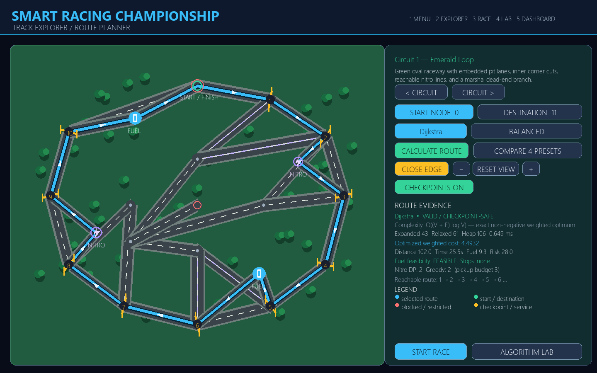
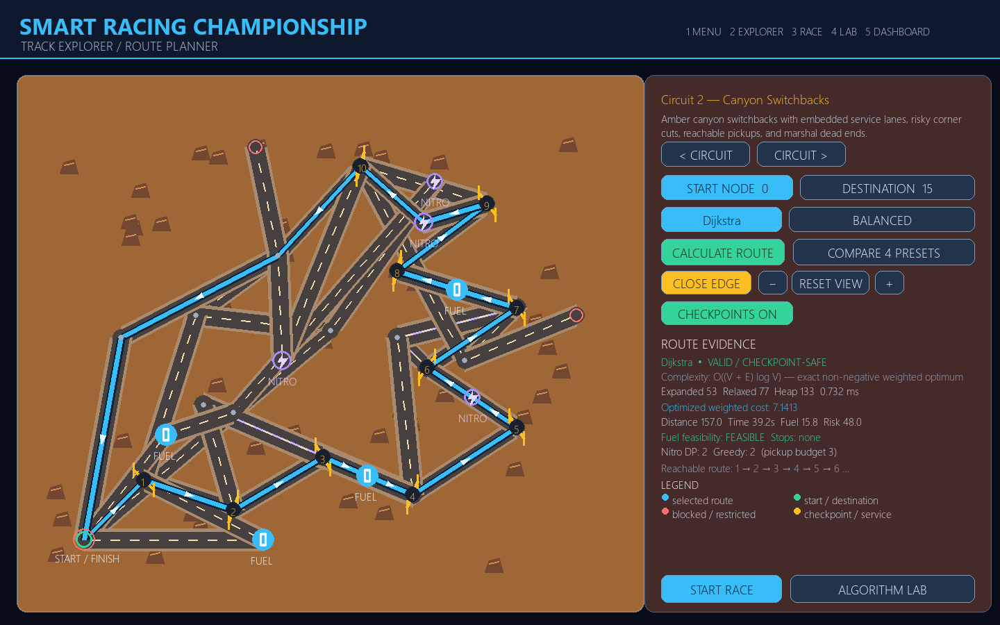
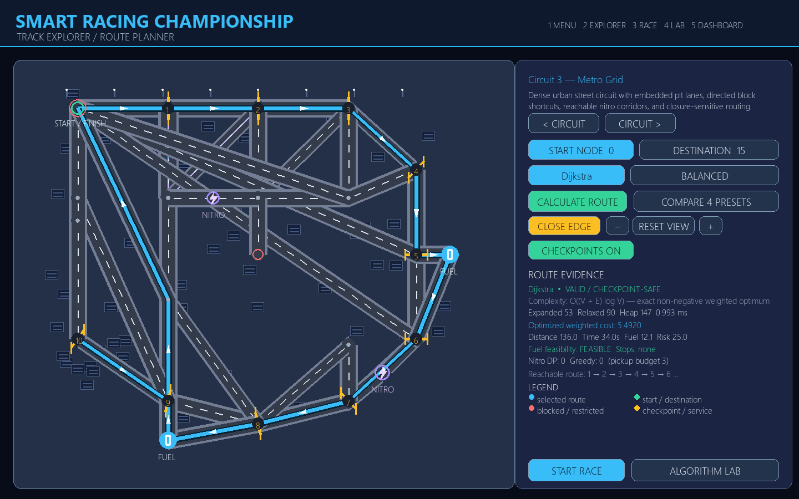

# Smart Racing Championship — Circuit Design Options

## Decision context

The assignment requires **three playable circuits**, not one: each must contain at least ten ordered checkpoints, two shortcuts, multiple intersections, alternative routes, a cycle, a dead end, fuel stations, nitro pickups, difficulty variation, dynamic road events, and multiple laps.

The repository now contains three redesigned authoritative circuits. This document records their intended gameplay roles and the topology decisions implemented after visual and algorithmic review.

## Requirement checklist

Every selected circuit must satisfy:

- 10 mandatory checkpoints visited in order.
- At least 2 legal shortcuts.
- A cycle and at least one dead-end branch.
- Multiple start-to-finish alternatives.
- Fuel stations and nitro pickups reachable from the racing network.
- Difficulty levels from easy to difficult.
- Open, blocked, restricted, and temporary-effect road states.
- Two or more laps with checkpoint reset after each lap.
- Deterministic routes for Dijkstra/A*, BFS/DFS exploration, DP/Greedy resources, and event-heap rerouting.

## Option 1 — Emerald Loop

### Layout

An easy-to-read oval forms the reliable main route. Two inner corner-cut corridors reduce distance without skipping the ordered checkpoint sequence. Fuel stations sit between two road edges on pit lanes, nitro pickups sit on optional racing lines, and a marshal branch provides a true dead end for DFS analysis.

### Gameplay role

This is the recommended opening circuit. It teaches the difference between BFS minimum-edge paths and Dijkstra/A* weighted routes without overwhelming the player.

### Resource and event placement

- Fuel stations: two embedded pit lanes, one before the finish approach and one on the lower loop.
- Nitro pickups: two reachable optional lines, one near the upper corner and one on the left infield.
- Shortcuts: four designated shortcut edges forming two distinct corridors.
- Events: early road blockage, timed shortcut toggle, oil spill, and speed restriction.

### Current implementation profile

| Property | Value |
|---|---:|
| Vertices | 22 |
| Edges | 32 |
| Ordered checkpoints | 10 |
| Shortcut edges / corridors | 4 / 2 |
| Fuel stations | 2 |
| Nitro pickups | 2 |
| Validator | Passes |

## Option 2 — Canyon Switchbacks

### Layout

A long serpentine ridge route crosses the canyon through switchbacks. High-difficulty shortcut corridors cut across two bends, while embedded service lanes appear before expensive sections. Reachable nitro vertices reward optional racing lines, and two marshal branches provide meaningful dead-end analysis without stranding resources.

### Gameplay role

This is the recommended strategy circuit. It creates the clearest trade-off between time, distance, fuel, difficulty, and obstacle risk, so it is the strongest circuit for the DP/Greedy resource demonstration and multi-objective comparison.

### Resource and event placement

- Fuel stations: four, positioned between road edges before and after the most expensive switchback sections.
- Nitro pickups: four, including pickups on normal and optional inner lines.
- Shortcuts: four designated shortcut edges forming two high-risk corridors.
- Events: closure on a main ridge, shortcut toggle, oil spill, and speed restriction force deterministic rerouting.

### Current implementation profile

| Property | Value |
|---|---:|
| Vertices | 30 |
| Edges | 45 |
| Ordered checkpoints | 10 |
| Shortcut edges / corridors | 4 / 2 |
| Fuel stations | 4 |
| Nitro pickups | 4 |
| Validator | Passes |

## Option 3 — Metro Grid

### Layout

A recognizable urban street circuit uses a perimeter lap, inner blocks, two directed one-way shortcut corridors, and pit lanes integrated between adjacent road nodes. The checkpoint order follows the perimeter, while the inner grid supplies alternative routes and a genuine dead-end inspection street.

### Gameplay role

This is the recommended advanced circuit. It best demonstrates live graph updates, directed-edge legality, heap event processing, route invalidation, and Algorithm Lab visualizations.

### Resource and event placement

- Fuel stations: two pit lanes embedded on opposite lower/right sections of the grid.
- Nitro pickups: two reachable vertices, including one in an inner block and one on a directed shortcut.
- Shortcuts: four directed shortcut edges forming two one-way corridors.
- Events: simultaneous road restrictions and shortcut changes are especially suitable here.

### Current implementation profile

| Property | Value |
|---|---:|
| Vertices | 24 |
| Edges | 42 |
| Ordered checkpoints | 10 |
| Shortcut edges / corridors | 4 / 2 |
| Fuel stations | 2 |
| Nitro pickups | 2 |
| Validator | Passes |

## Comparison

| Criterion | Emerald Loop | Canyon Switchbacks | Metro Grid |
|---|---:|---:|---:|
| Beginner readability | Excellent | Moderate | Moderate |
| Route-choice depth | Moderate | Excellent | Excellent |
| Fuel-planning value | Good | Excellent | Good |
| Dynamic-closure value | Good | Excellent | Excellent |
| Directed-graph value | Low | Low | Excellent |
| Visual identity | Grass / forest | Desert / canyon | Urban / night |
| Best role | Opening race | Strategy race | Final technical race |

## Recommendation

Choose **all three as the final championship set**, in this order:

1. Emerald Loop — onboarding and BFS/DFS exploration.
2. Canyon Switchbacks — fuel, nitro, risk, and multi-objective strategy.
3. Metro Grid — directed roads, dynamic closures, heap events, and final challenge.

This is stronger than selecting only one circuit because the assignment explicitly requires three playable circuits and the progression gives each major algorithmic idea a natural gameplay role.

## Decision points before further track changes

Only change the active JSON tracks if one of these decisions changes:

- The checkpoint order should be made easier or harder.
- Shortcuts should be more or less dominant in the weighted presets.
- The Canyon circuit should have fewer service stations to increase resource pressure.
- The Metro circuit should use more directed roads for a harder final race.

The current three validated designs are the reproducible baseline for routing, experiments, screenshots, and the submission package.
