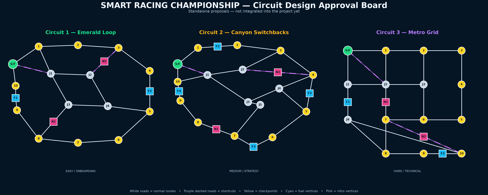

# Circuit Design Approval Pack

These are standalone design proposals for review. They are **not integrated into the game** and do not replace any active track JSON file.

## Preview board

## Individual circuits

- [Circuit 1 — Emerald Loop](emerald_loop_practical_v2.png) — easy onboarding loop with inner connector options.
- [Circuit 2 — Canyon Switchbacks](canyon_switchbacks_practical_v2.png) — medium strategy circuit with switchback trade-offs.
- [Circuit 3 — Metro Grid](metro_grid_practical_v2.png) — hard technical grid with shortcut corridors and closure-routing value.

## Design contract shown in each PNG

- Ten ordered checkpoints.
- At least two explicitly marked shortcuts.
- A closed main route plus alternative paths.
- Junctions and resource-access branches that can act as dead ends.
- Fuel stations and nitro pickups.
- Fuel and nitro vertices embedded in normal or shortcut road sequences, each with road edges on both sides.
- A visual distinction between normal roads, shortcuts, and resource vertices.

## Approval gate

No implementation work should begin until the user approves the circuit layouts. Approval can be given with:

> Approved — use all three circuits as shown.

Or request a change such as:

> Modify Circuit 2: add one more shortcut and move the fuel station before checkpoint 6.

After approval, the graph definitions can be converted into project track data and validated before integration into the race engine.
